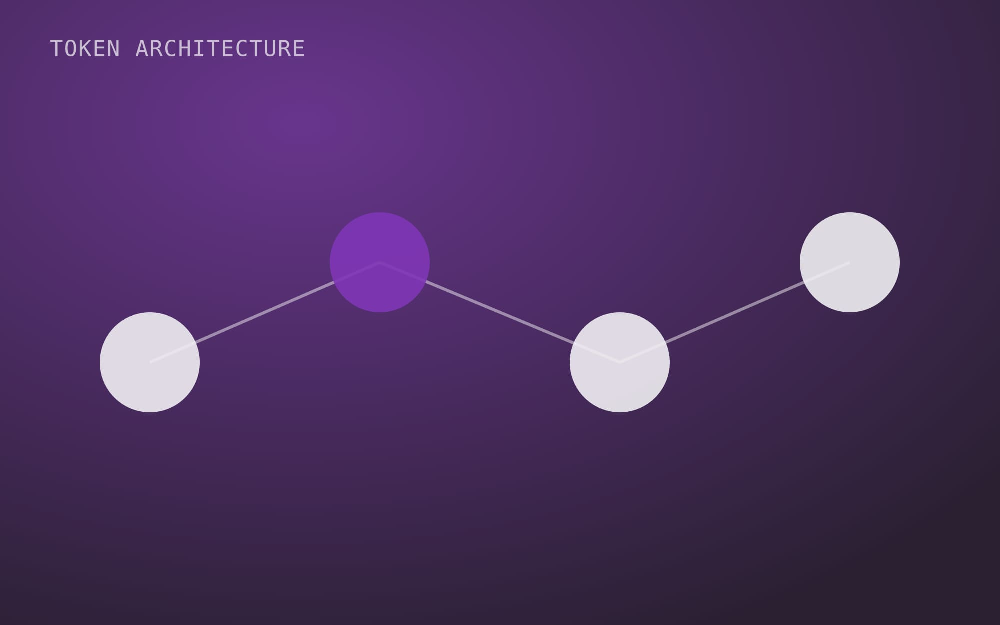

## Why a design system

Each of Orbis' products had been built by a different team. Customers who used two of them had to relearn basic patterns like filters, tables and dialogs.

<Decision title="Start with tokens, not components">
  The products used different front-end stacks, so a shared component library was not realistic in year one. Tokens worked everywhere and created a common language first.
</Decision>

[Screen: Component overview in Figma with adoption status per product]

## Outcome

<Outcome type="achieved">
  - New screens ship about a third faster, measured over [...] releases.
  - [...] of 3 products use the semantic tokens in production.
</Outcome>

<Reflection>
  - [...]
</Reflection>
