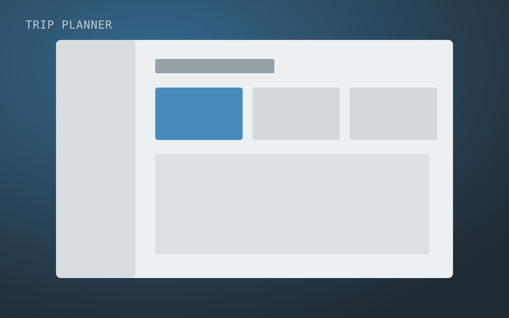

## Context

Lakeline runs buses and regional trains across three cantons. Its journey planner was built on static timetables, so delays only showed up once people were already waiting.

<Decision title="Design for the broken plan, not the perfect one">
  Most visits happened after something had gone wrong. We made disruptions and alternatives the main content of a trip, instead of a red banner on top of the timetable.
</Decision>

## Outcome

<Outcome type="achieved">
  - Satisfaction with the planner rose from 3.1 to 4.4.
  - Calls to the service hotline during disruptions dropped by a quarter.
</Outcome>
